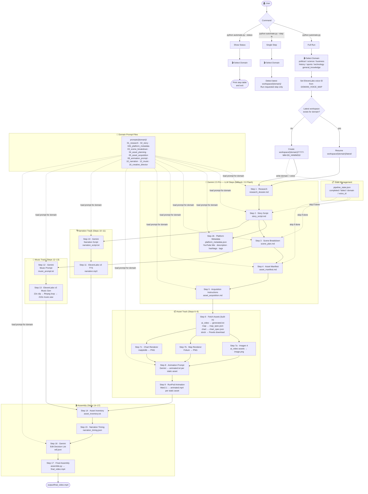

# Pipeline Overview

## Flow Diagram



## Goals

Replace all manual steps in `pipeline.py` with a single automated script `automate.py`. The script calls Gemini 2.5 Pro for all LLM and creative tasks, ElevenLabs v3 for narration and music, Imagen 4 for AI image generation, and RunPod for video animation. Steps 14, 15, and 17 call external scripts via subprocess.

## Key Decisions

| Concern | Decision |
|---------|----------|
| LLM | `gemini-2.5-pro`; falls back to `gemini-2.0-flash` on 429 quota errors |
| Image gen | Imagen 4 (`imagen-4.0-generate-001`) for `ai_video` assets (step 7a) |
| Map gen | Folium → headless Playwright screenshot (step 7b) |
| Chart gen | matplotlib → PNG (step 7c) |
| TTS & Music | ElevenLabs model v3 |
| Voice | Domain chosen upfront → maps to `DOMAIN_VOICE_MAP` |
| Domains | Interactive menu at startup: `political`, `general_knowledge`, `science`, `business`, `history`, `sports`, `technology` |
| Prompts | Domain-specific files under `prompts/{domain}/` |
| Workspace | Scoped per domain — `workspace/{domain}/YYYY-MM-DD_HHMMSS/`; latest auto-resumed |
| Resumability | `pipeline_state.json` tracks completed steps and domain |
| Platform metadata | Step 2b — Gemini generates YouTube title/description/hashtags/tags; stored in `platform_metadata.json` with a `youtube` key (IG/TikTok added later) |
| Video animation | RunPod serverless (Wan2.1) — `RUNPOD_ENDPOINT` is a placeholder; set before running step 9 |
| Assembly | ffmpeg via `assemble.py` (step 17) driven by `edl.json` |
| API keys | Loaded from `.keys` via `source .keys` before running |

## Execution Order

```
1   → run_gemini_step()           # research_dossier.md
2   → run_gemini_step()           # story_script.md
2b  → run_gemini_step()           # platform_metadata.json (YouTube title, description, hashtags, tags)
3   → run_gemini_step()           # scene_plan.md
4   → run_gemini_step()           # asset_manifest.md
5   → run_gemini_step()           # asset_acquisition.md
6   → run_fetch_assets()          # generated.txt / map_spec.json / chart_spec.json / Pexels downloads
7a  → run_imagen_generation()     # image.png per ai_video asset
7b  → run_map_generation()        # map.png per map asset (Folium)
7c  → run_chart_generation()      # chart.png per chart asset (matplotlib)
8   → run_animation_prompt_step() # animated.txt per static asset (Gemini)
9   → run_runpod_animation()      # animated.mp4 per static asset (RunPod — placeholder config)
10  → run_gemini_step()           # narration_script.txt  [uses 08_narration.md]
11  → run_elevenlabs_tts()        # narration.mp3
12  → run_gemini_step()           # music_prompt.txt  [uses 10_music.md]
13  → run_elevenlabs_music()      # music.wav (22s clip → looped to 210s via ffmpeg)
14  → run_script()                # asset_inventory.txt
15  → run_script()                # narration_timing.json
16  → run_gemini_step()           # edl.json  [uses 13_creative_director.md]
17  → run_script()                # output/final_video.mp4 (assemble.py)
```
