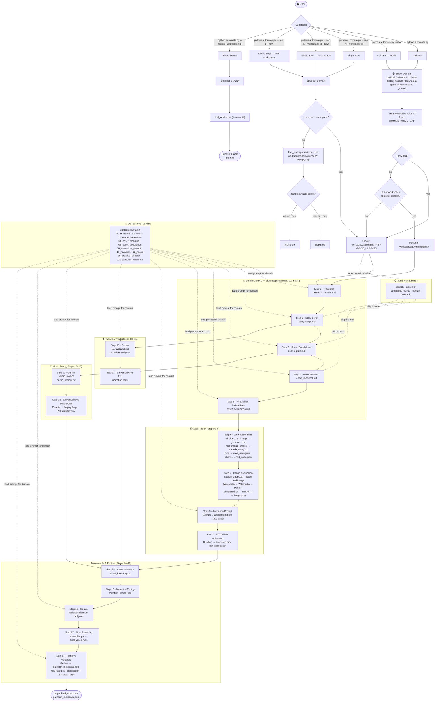

# Pipeline Overview

## Flow Diagram



## Goals

Replace all manual steps in `pipeline.py` with a single automated script `automate.py`. The script calls Gemini 2.5 Pro for all LLM and creative tasks, ElevenLabs v3 for narration and music, Imagen 4 for AI image generation, Wikipedia/Wikimedia/Pexels for real-world images, and RunPod (LTX-Video) for video animation. Steps 14, 15, and 17 call external scripts via subprocess.

## Key Decisions

| Concern | Decision |
|---------|----------|
| LLM | `gemini-2.5-pro`; falls back to `gemini-2.0-flash` on 429 quota errors |
| Image gen | Imagen 4 (`imagen-4.0-generate-001`) for `ai_video` / `ai_image` assets (step 7) |
| Real-world images | `real_image` / `image` types → fetched in step 7 via Wikipedia → Wikimedia Commons → Pexels fallback |
| Asset types | `ai_video`, `ai_image`, `real_image`, `image`, `map`, `chart` — defined in step 5 prompt |
| Step 6 | Writes text/spec files only (`generated.txt`, `search_query.txt`, `map_spec.json`, `chart_spec.json`) — no network calls |
| Step 7 | Two passes: web-fetch pass (`search_query.txt` → `image.jpg`), then Imagen pass (`generated.txt` → `image.png`) |
| TTS & Music | ElevenLabs model v3 |
| Voice | Domain chosen upfront → maps to `DOMAIN_VOICE_MAP` |
| Domains | Interactive menu at startup: `political`, `general_knowledge`, `science`, `business`, `history`, `sports`, `technology`, `general` |
| Prompts | Domain-specific files under `prompts/{domain}/` |
| Workspace | Scoped per domain — `workspace/{domain}/YYYY-MM-DD_HHMMSS/`; each run gets its own folder, previous workspaces are never overwritten |
| Resumability | `pipeline_state.json` tracks completed steps and domain; default full run resumes latest workspace |
| `--step` / `--status` | Both require `--workspace <id>`; `--step` skips if output exists unless `--new` is also passed. **Exception: step 7 always runs (per-asset check)** |
| `--new` | With `--step --workspace`: force re-runs the step. With `--step 7`: deletes all existing images then regenerates all. With `--step 1` only: creates a fresh workspace |
| `--workspace <id>` | Targets a specific workspace by time ID (e.g. `200619` from `2026-06-12_200619`) |
| Platform metadata | Step 18 — runs last after final assembly; Gemini generates YouTube title/description/hashtags/tags from research + story |
| Video animation | RunPod pod running LTX-Video I2V server (`runpod/server.py`) on port 8080 |
| Assembly | ffmpeg via `assemble.py` (step 17) driven by `edl.json` |
| API keys | Loaded from `.keys` via `source .keys` before running |

## Execution Order

```
1   → run_gemini_step()           # research_dossier.md
2   → run_gemini_step()           # story_script.md
3   → run_gemini_step()           # scene_plan.md
4   → run_gemini_step()           # asset_manifest.md
5   → run_gemini_step()           # asset_acquisition.md
6   → run_fetch_assets()          # generated.txt / search_query.txt / map_spec.json / chart_spec.json
7   → run_imagen_generation()     # pass 1: search_query.txt → image.jpg (Wikipedia/Wikimedia/Pexels)
                                  # pass 2: generated.txt → image.png (Imagen 4)
8   → run_animation_prompt_step() # animated.txt per static asset (Gemini, uses 08_animation_prompt.md)
9   → run_runpod_animation()      # animated.mp4 per static asset (LTX-Video on RunPod)
10  → run_gemini_step()           # narration_script.txt  [uses 10_narration.md]
11  → run_elevenlabs_tts()        # narration.mp3
12  → run_gemini_step()           # music_prompt.txt  [uses 12_music.md]
13  → run_elevenlabs_music()      # music.wav (22s clip → looped to 210s via ffmpeg)
14  → run_script()                # asset_inventory.txt
15  → run_script()                # narration_timing.json
16  → run_gemini_step()           # edl.json  [uses 16_creative_director.md]
17  → run_script()                # output/final_video.mp4 (assemble.py)
18  → run_gemini_step()           # platform_metadata.json  [uses 02b_platform_metadata.md]
```
