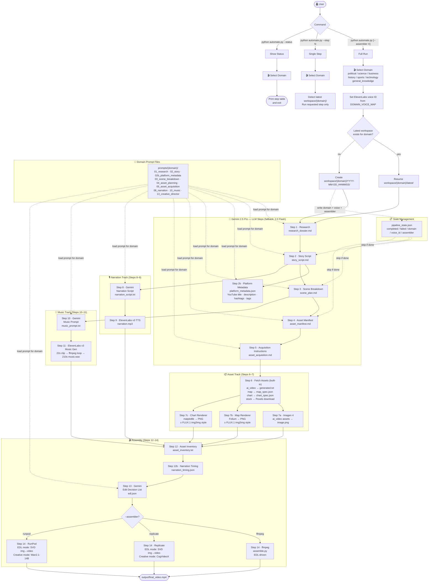

# Pipeline Overview

## Flow Diagram



## Goals

Replace all manual steps in `pipeline.py` with a single automated script `automate.py`. The script calls Gemini 2.5 Pro for all LLM and creative tasks, ElevenLabs v3 for narration and music, and Imagen 4 for AI image generation. Steps 12, 12b, and 14 call external scripts via subprocess (ffmpeg mode) or assembler modules (replicate/runpod modes).

## Key Decisions

| Concern | Decision |
|---------|----------|
| LLM | `gemini-2.5-pro`; falls back to `gemini-2.0-flash` on 429 quota errors |
| Image gen | Imagen 4 (`imagen-4.0-generate-001`) for `ai_video` assets (step 7a) |
| Map gen | Folium → headless Playwright screenshot → optional FLUX.1 img2img style (step 7b) |
| Chart gen | matplotlib → PNG → optional FLUX.1 img2img style (step 7c) |
| TTS & Music | ElevenLabs model v3 |
| Voice | Domain chosen upfront → maps to `DOMAIN_VOICE_MAP` |
| Domains | Interactive menu at startup: `political`, `general_knowledge`, `science`, `business`, `history`, `sports`, `technology` |
| Prompts | Domain-specific files under `prompts/{domain}/` |
| Workspace | Scoped per domain — `workspace/{domain}/YYYY-MM-DD_HHMMSS/`; latest auto-resumed |
| Resumability | `pipeline_state.json` tracks completed steps, domain, assembler |
| Platform metadata | Step 2b — Gemini generates YouTube title/description/hashtags/tags; stored in `platform_metadata.json` with a `youtube` key (IG/TikTok added later) |
| Assembler | `--assembler ffmpeg` (default) \| `replicate` \| `runpod`; each supports EDL-driven and creative modes |
| API keys | Loaded from `.keys` via `source .keys` before running |

## Execution Order

```
1   → run_gemini_step()       # research_dossier.md
2   → run_gemini_step()       # story_script.md
2b  → run_gemini_step()       # platform_metadata.json (YouTube title, description, hashtags, tags)
3   → run_gemini_step()       # scene_plan.md
4   → run_gemini_step()       # asset_manifest.md
5   → run_gemini_step()       # asset_acquisition.md
6   → run_fetch_assets()      # generated.txt / map_spec.json / chart_spec.json / Pexels downloads
7a  → run_imagen_generation() # image.png per ai_video asset
7b  → run_map_generation()    # map.png per map asset (Folium + optional FLUX.1)
7c  → run_chart_generation()  # chart.png per chart asset (matplotlib + optional FLUX.1)
8   → run_gemini_step()       # narration_script.txt
9   → run_elevenlabs_tts()    # narration.mp3
10  → run_gemini_step()       # music_prompt.txt
11  → run_elevenlabs_music()  # music.wav (22s clip → looped to 210s via ffmpeg)
12  → run_script()            # asset_inventory.txt
12b → run_script()            # narration_timing.json
13  → run_gemini_step()       # edl.json
14  → run_assembler()         # output/final_video.mp4
```
