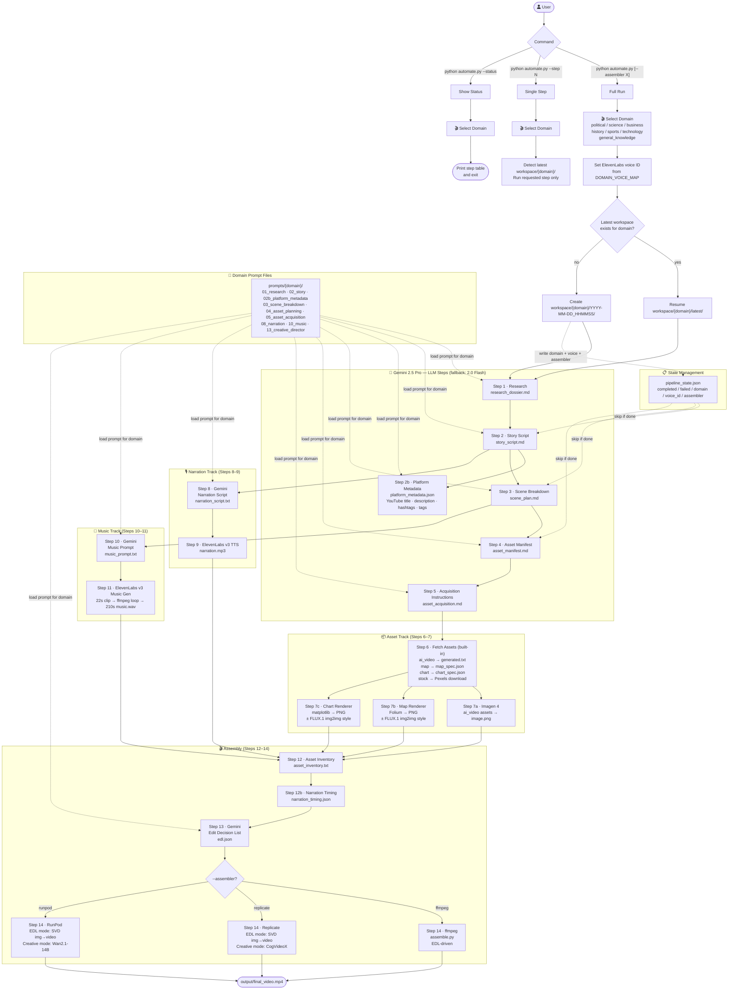

# Vid Life — Full Pipeline Automation

## Pipeline Flow



## Context & Goals

Replace all manual steps in `pipeline.py` with a single automated script `automate.py`. The script calls Gemini 2.5 Pro for all LLM and creative tasks, ElevenLabs v3 for narration and music, and Imagen 4 for AI image generation. Asset fetching (step 6) is implemented inline in `automate.py`. Steps 12, 12b, and 14 still call external scripts via subprocess (ffmpeg mode) or assembler modules (replicate/runpod modes).

**Key decisions made:**
- LLM: `gemini-2.5-pro` for steps 1–5, 8, 10, 13; falls back to `gemini-2.0-flash` on quota errors
- Image gen: Imagen 4 (`imagen-4.0-generate-001`) for step 7a (ai_video assets)
- Map gen: Folium → headless Playwright screenshot → optional FLUX.1 img2img style (step 7b)
- Chart gen: matplotlib → PNG → optional FLUX.1 img2img style (step 7c)
- TTS & Music: ElevenLabs model v3 (hardcoded API key)
- Voice selection: domain chosen upfront by user → maps to hardcoded domain→voice-ID dict
- Topic/domain: user selects from interactive numbered menu at startup (political, general_knowledge, science, business, history, sports, technology)
- Domain-specific prompts: each domain has its own prompt files under `prompts/{domain}/` (steps 1–5, 8, 10, 13)
- Workspace: scoped per domain — `workspace/{domain}/YYYY-MM-DD_HHMMSS/`; latest workspace for the chosen domain is auto-resumed; fresh start if none exists
- Resumability: state JSON tracks completed steps, domain, and assembler; `--step N` shows domain menu then resumes latest workspace for that domain
- Fetch assets: inline in `automate.py` (no external scripts folder needed)
- Platform metadata (step 2b): Gemini generates YouTube title, description, hashtags, and SEO tags from the story script; output is `platform_metadata.json` with a `youtube` key; IG and TikTok keys will be added later without breaking existing structure
- No Python library exists for generating YouTube metadata from a script — Gemini is used with a domain-specific prompt (`prompts/{domain}/02b_platform_metadata.md`)
- Assembler: `--assembler ffmpeg` (default, existing behaviour) | `replicate` | `runpod`; each supports EDL-driven and creative composition modes
- CLI: `python automate.py [--assembler ffmpeg|replicate|runpod]` (full run) | `python automate.py --step N` | `python automate.py --status`

**API keys location:** hardcoded constants at top of `automate.py` (same pattern as `lets-try.md`)

---

## Implement core scaffolding (`automate.py`)

Set up the entry point, configuration constants, CLI parsing, workspace creation, and state management. This is the foundation everything else builds on.

### Define configuration constants

At the top of `automate.py`, declare all hardcoded values:

```python
GEMINI_API_KEY        = "..."
GEMINI_MODEL          = "gemini-2.5-pro"
GEMINI_FALLBACK_MODEL = "gemini-2.0-flash"   # used on 429 quota errors

ELEVENLABS_API_KEY = "..."
ELEVENLABS_MODEL   = "eleven_v3"

IMAGEN_MODEL = "imagen-4.0-generate-001"

REPLICATE_API_KEY = "..."   # for --assembler replicate and optional FLUX.1 map/chart styling
RUNPOD_API_KEY    = "..."   # for --assembler runpod

PEXELS_API_KEY  = "..."
PIXABAY_API_KEY = "..."

DOMAIN_VOICE_MAP = {
    "political":         "pNInz6obpgDQGcFmaJgB",   # Adam
    "general_knowledge": "onwK4e9ZLuTAKqWW03F9",   # Daniel
    "science":           "N2lVS1w4EtoT3dr4eOWO",   # Callum
    "business":          "XB0fDUnXU5powFXDhCwa",   # Charlotte
    "history":           "IKne3meq5aSn9XLyUdCD",   # Charlie
    "sports":            "ErXwobaYiN019PkySvjV",    # Antoni (placeholder)
    "technology":        "pqHfZKP75CvOlQylNhV4",   # Bill
}

SUPPORTED_DOMAINS = list(DOMAIN_VOICE_MAP.keys())
```

### Implement CLI argument parsing

```
python automate.py                          # pick domain, resume or start workspace, run full pipeline (ffmpeg assembler)
python automate.py --assembler replicate   # same, but Step 14 uses Replicate
python automate.py --assembler runpod      # same, but Step 14 uses RunPod
python automate.py --step 3               # pick domain, re-run one step in latest workspace for that domain
python automate.py --status               # pick domain, print step table and exit
```

Use `argparse`. `--step` accepts int or string (for `12b`). `--assembler` defaults to `ffmpeg`. All three modes show the domain selection menu first.

```python
parser.add_argument("--assembler", choices=["ffmpeg", "replicate", "runpod"],
                    default="ffmpeg", help="Assembly backend for Step 14")
```

### Domain selection menu

At startup, print a numbered list of all supported domains. Accept only a valid number — loop until one is entered. The chosen domain determines the prompt directory, voice ID, and workspace path.

### Implement domain-scoped workspace creation

Workspaces live at `workspace/{domain}/YYYY-MM-DD_HHMMSS/`. On a full run, `latest_workspace(domain)` finds the most recent folder for that domain — if found, it is resumed; if not, a fresh workspace is created and the domain, voice ID, and assembler are written into `pipeline_state.json` immediately. `--step N` and `--status` also call `latest_workspace(domain)` after the menu.

### Implement state file (resumability)

State file: `{workspace}/pipeline_state.json`

```json
{
  "completed": ["1", "2", "3"],
  "failed": [],
  "voice_id": "<selected_voice>",
  "domain": "political",
  "assembler": "ffmpeg"
}
```

- `load_state()` / `save_state()` helpers
- Before running a step: check if its output file already exists → skip and log "already done"
- After successful step: append step ID to `completed`
- On exception: append to `failed`, print error, continue to next step (don't abort entire run)

---

## Implement Gemini LLM runner (Steps 1–5, 8, 10, 13)

A reusable function that loads a prompt file, substitutes template variables, calls Gemini 2.5 Pro, and saves output to the workspace.

### Build `run_gemini_step(step, ws, state)` function

1. Read `state["domain"]` to determine the prompt directory
2. Load prompt file from `prompts/{domain}/` using `resolve_prompt_file(step_id, domain)`
3. Substitute `{{variable_name}}` placeholders with contents of previous workspace outputs
4. Call Gemini via `gemini_generate(prompt)` — falls back to `gemini-2.0-flash` automatically on 429
5. Write raw text response to workspace as the step's output file

#### Prompt file discovery — `resolve_prompt_file(step_id, domain)`

All prompt files live in `prompts/{domain}/` and follow a single naming convention: `NN_name.md` where `NN` is the step number. Scan the domain directory for a file whose numeric prefix matches the step ID.

```python
def resolve_prompt_file(step_id: str, domain: str) -> Path:
    domain_dir = PROMPTS_DIR / domain
    for f in domain_dir.iterdir():
        if re.match(rf"^0*{re.escape(step_id)}[_.]", f.name):
            return f
    raise FileNotFoundError(f"No prompt file for step {step_id} in {domain_dir}")
```

#### Prompt files and template variables

| Step | Prompt file | Variables injected | Output file |
|------|-------------|-------------------|-------------|
| 1 | `01_research.md` | none | `research_dossier.md` |
| 2 | `02_story.md` | `{{research_dossier}}` | `story_script.md` |
| 2b | `02b_platform_metadata.md` | `{{story_script}}` | `platform_metadata.json` |
| 3 | `03_scene_breakdown.md` | `{{story_script}}` | `scene_plan.md` |
| 4 | `04_asset_planning.md` | `{{scene_plan}}` | `asset_manifest.md` |
| 5 | `05_asset_acquisition.md` | `{{asset_manifest}}` | `asset_acquisition.md` |
| 8 | `08_narration.md` | `{{story_script}}` | `narration_script.txt` |
| 10 | `10_music.md` | `{{scene_plan}}` | `music_prompt.txt` |
| 13 | `13_creative_director.md` | `{{asset_inventory}}` + `{{narration_timing}}` | `edl.json` |

#### Gemini API call with quota fallback

```python
from google import genai
from google.genai.errors import ClientError

def gemini_generate(prompt: str, model: str = GEMINI_MODEL) -> str:
    client = genai.Client(api_key=GEMINI_API_KEY)
    try:
        return client.models.generate_content(model=model, contents=prompt).text
    except ClientError as e:
        if e.code == 429 and model == GEMINI_MODEL:
            print(f"[WARN] Quota exhausted — falling back to {GEMINI_FALLBACK_MODEL}")
            return gemini_generate(prompt, model=GEMINI_FALLBACK_MODEL)
        raise
```

Step 13 output must be valid JSON — strip markdown code fences before saving as `edl.json`. Validate with `json.loads()` and raise on failure.

---

## Implement platform metadata generation (Step 2b)

Generates YouTube publishing metadata from the story script. No Python library exists for this — Gemini is called with a domain-specific prompt. Output is structured JSON so future platforms (IG, TikTok) can be added as new keys without changing the step logic.

### Output file: `platform_metadata.json`

```json
{
  "youtube": {
    "title": "Why Germany's Energy Gamble Failed Everyone",
    "description": "Germany bet billions on a green energy transition — and it backfired...\n\nWhat you'll learn:\n• Why the Energiewende plan collapsed\n• The political decisions that made it worse\n• What this means for Europe's energy future\n\n⏱ TIMESTAMPS\n\n🔔 Subscribe for more political documentaries every week.",
    "hashtags": ["#Politics", "#Germany", "#Energy", "#Documentary", "#Geopolitics"],
    "tags": ["germany energy crisis", "energiewende failure", "european energy policy", "political documentary", "green energy germany"]
  }
}
```

The `youtube` key is the only one populated now. When IG and TikTok support is added, append `"instagram"` and `"tiktok"` keys to the same file — no schema migration needed.

### Implementation notes

Step 2b runs immediately after step 2 and before step 3. It does not block the scene breakdown or narration tracks — all three depend only on `story_script.md`.

The Gemini response must be valid JSON. Apply the same code-fence stripping and `json.loads()` validation used in step 13:

```python
raw = gemini_generate(prompt)
raw = re.sub(r"^```(?:json)?\s*|\s*```$", "", raw.strip())
data = json.loads(raw)   # raises on invalid JSON — step is marked failed, run continues
```

Save the parsed dict (not raw text) as `platform_metadata.json` via `json.dump`.

### Prompt files (one per domain)

Each domain has a tailored persona and keyword focus, stored at `prompts/{domain}/02b_platform_metadata.md`. All seven files follow the same structure:

| Domain | Persona | Hashtag focus |
|--------|---------|--------------|
| political | Investigative journalism SEO specialist | #Politics #Documentary #Geopolitics |
| general_knowledge | Educational explainer SEO specialist | #Education #Learning #Facts |
| science | STEM documentary SEO specialist | #Science #Documentary #STEM |
| business | Business/finance documentary SEO specialist | #Business #Finance #Entrepreneurship |
| history | Historical documentary SEO specialist | #History #Documentary #HistoryChannel |
| sports | Sports documentary SEO specialist | #Sports #Documentary #Athletics |
| technology | Tech/innovation documentary SEO specialist | #Technology #AI #Innovation |

### Extending to IG and TikTok (future)

When ready, add `prompts/{domain}/02b_platform_metadata.md` prompt rules for `instagram` and `tiktok` keys. The step runner, output file, and JSON schema require no changes — Gemini simply populates additional keys in the same object.

---

## Domain and voice selection

Domain is chosen by the user via interactive menu before the pipeline starts — no classification step needed. The selected domain and its corresponding `voice_id` from `DOMAIN_VOICE_MAP` are written into `pipeline_state.json` when the workspace is first created and read by all subsequent steps.

---

## Implement ElevenLabs TTS automation (Step 9)

Automate narration audio generation using the ElevenLabs API with model v3.

### Build `run_elevenlabs_tts(workspace_dir)` function

1. Read `{workspace}/narration_script.txt`
2. Extract the `=== ELEVENLABS VERSION ===` section — everything after that marker. This section already contains `<break time="2.0s"/>` between scenes and `<break time="1.5s"/>` mid-sentence, as produced by `08_narration.md`. No further tag injection needed.
3. The extracted text is v3-ready as-is — `08_narration.md` already instructs Gemini to produce only `<break time="Xs"/>` tags (which ElevenLabs v3 interprets natively) and no custom tags.
4. Load `voice_id` from `pipeline_state.json`
5. Call ElevenLabs TTS API:

```python
import requests

url = f"https://api.elevenlabs.io/v1/text-to-speech/{voice_id}"
headers = {"xi-api-key": ELEVENLABS_API_KEY, "Content-Type": "application/json"}
payload = {
    "text": narration_text,
    "model_id": ELEVENLABS_MODEL,
    "voice_settings": {"stability": 0.5, "similarity_boost": 0.75}
}
response = requests.post(url, json=payload, headers=headers)
```

6. Save response bytes to `{workspace}/narration.mp3`

---

## Implement ElevenLabs Music automation (Step 11)

### Build `run_elevenlabs_music(step, ws, state)` function

1. Read `{workspace}/music_prompt.txt`
2. Truncate to 450 characters if needed — ElevenLabs hard limit; print `[WARN]` if truncated
3. Call ElevenLabs sound-generation API (max 22s per request):

```python
url = "https://api.elevenlabs.io/v1/sound-generation"
payload = {"text": music_prompt, "duration_seconds": 22, "prompt_influence": 0.3}
```

4. Save the 22s clip to `{workspace}/music.wav`
5. Extend to 210s using ffmpeg — loop the clip, fade out over the final 10 seconds:

```bash
ffmpeg -stream_loop -1 -i music.wav -t 210 -af "afade=t=out:st=200:d=10" music_extended.wav
```

6. Replace `music.wav` with the extended version. If ffmpeg fails, keep the 22s clip and log a warning.

**Music prompt constraints (`10_music.md`):**
- Must say "instrumental only, no vocals, soft background music" — the track plays under narration at reduced volume
- Under 450 characters total (ElevenLabs hard limit) — aim for 300–420 characters
- Describe a loopable emotional arc — the 22s clip will be repeated, so avoid abrupt endings

---

## Implement asset generation (Step 7)

Step 7 is split into three parallel sub-steps, each handling a different asset type written by Step 6.

### Step 7a — Imagen 4 image generation

Automate AI image generation for all assets that have a `generated.txt` prompt file (written by step 6).

#### Build `run_imagen_generation(step, ws, state)` function

1. Scan `{workspace}/assets/` recursively for all `generated.txt` files
2. For each file:
   - Skip if `image.png` already exists in the same folder (resumability)
   - Read the image generation prompt text
   - Call Imagen 4 via `google.genai` SDK:

```python
from google import genai
from google.genai import types

client = genai.Client(api_key=GEMINI_API_KEY)
response = client.models.generate_images(
    model=IMAGEN_MODEL,   # "imagen-4.0-generate-001"
    prompt=image_prompt,
    config=types.GenerateImagesConfig(number_of_images=1),
)
```

   - Save the generated image as `image.png` in the same directory as `generated.txt`
3. Log each generation: `scene_X/asset_Y → image.png`

### Step 7b — Map generation

Renders geographic maps from `map_spec.json` files written by Step 6.

#### Asset manifest format for maps

Step 4/5 prompts must output map entries in this format:

```json
{
  "type": "map",
  "location": "Berlin, Germany",
  "lat": 52.52,
  "lon": 13.405,
  "zoom": 10,
  "markers": [{"lat": 52.52, "lon": 13.405, "label": "Brandenburg Gate"}],
  "style": "dark"
}
```

#### Build `run_map_generation(ws)` function

1. Scan `{workspace}/assets/` recursively for all `map_spec.json` files
2. For each file:
   - Skip if `map.png` already exists in the same folder (resumability)
   - Render with Folium → save as HTML → screenshot with headless Playwright → `map.png`
   - If `style` field is set and `REPLICATE_API_KEY` is available, pass through FLUX.1 img2img for cinematic look

```python
import folium
from playwright.sync_api import sync_playwright

def render_map(spec: dict, output_dir: Path) -> Path:
    m = folium.Map(location=[spec["lat"], spec["lon"]], zoom_start=spec["zoom"])
    for marker in spec.get("markers", []):
        folium.Marker([marker["lat"], marker["lon"]], popup=marker["label"]).add_to(m)
    html_path = output_dir / "map.html"
    m.save(str(html_path))
    png_path = output_dir / "map.png"
    with sync_playwright() as p:
        browser = p.chromium.launch()
        page = browser.new_page(viewport={"width": 1920, "height": 1080})
        page.goto(f"file://{html_path}")
        page.screenshot(path=str(png_path))
        browser.close()
    return png_path
```

### Step 7c — Chart generation

Renders data charts from `chart_spec.json` files written by Step 6.

#### Asset manifest format for charts

```json
{
  "type": "chart",
  "chart_type": "bar",
  "title": "GDP Growth 2015–2024",
  "data": {"labels": ["2015", "2016", "2017"], "values": [2.1, 2.3, 1.8]},
  "style": "cinematic"
}
```

#### Build `run_chart_generation(ws)` function

1. Scan `{workspace}/assets/` recursively for all `chart_spec.json` files
2. For each file:
   - Skip if `chart.png` already exists (resumability)
   - Render with matplotlib (bar, line, pie, area) on dark background → `chart.png`
   - If `style` is set and `REPLICATE_API_KEY` is available, pass through FLUX.1 img2img

```python
import matplotlib.pyplot as plt

def render_chart(spec: dict, output_dir: Path) -> Path:
    fig, ax = plt.subplots(figsize=(16, 9), facecolor="black")
    ax.set_facecolor("black")
    ax.tick_params(colors="white")
    ax.title.set_color("white")
    labels = spec["data"]["labels"]
    values = spec["data"]["values"]
    if spec["chart_type"] == "bar":
        ax.bar(labels, values, color="#4A90D9")
    elif spec["chart_type"] == "line":
        ax.plot(labels, values, color="#4A90D9", linewidth=2, marker="o")
    ax.set_title(spec["title"])
    out = output_dir / "chart.png"
    fig.savefig(out, dpi=120, bbox_inches="tight", facecolor="black")
    plt.close()
    return out
```

---

## Implement pipeline orchestration and existing script integration

Wire all steps into a single ordered execution sequence with error handling and subprocess calls to the existing automated scripts.

### Execution order

```
1  → run_gemini_step()          # research_dossier.md
2  → run_gemini_step()          # story_script.md
2b → run_gemini_step()          # platform_metadata.json (YouTube title, description, hashtags, tags)
3  → run_gemini_step()          # scene_plan.md
4  → run_gemini_step()          # asset_manifest.md  (now includes map/chart asset types)
5  → run_gemini_step()          # asset_acquisition.md
6  → run_fetch_assets()         # built-in: writes generated.txt / map_spec.json / chart_spec.json / downloads stock
7a → run_imagen_generation()    # image.png per ai_video asset
7b → run_map_generation()       # map.png per map asset (Folium + optional FLUX.1)
7c → run_chart_generation()     # chart.png per chart asset (matplotlib + optional FLUX.1)
8  → run_gemini_step()          # narration_script.txt
9  → run_elevenlabs_tts()       # narration.mp3
10 → run_gemini_step()          # music_prompt.txt
11 → run_elevenlabs_music()     # music.wav (22s ElevenLabs clip → looped to 210s via ffmpeg)
12 → run_script()               # asset_inventory.txt  (generate_inventory.py)
12b→ run_script()               # narration_timing.json (analyze_timing.py)
13 → run_gemini_step()          # edl.json
14 → run_assembler()            # output/final_video.mp4 — dispatches to ffmpeg / replicate / runpod
```

### Step 6 — fetch assets (built-in)

`run_fetch_assets()` is implemented directly in `automate.py` — no external script needed. It parses `asset_acquisition.md` and for each asset:
- `ai_video` → writes `generated.txt` with the Imagen prompt
- `map` → writes `map_spec.json` with coordinates and marker data
- `chart` → writes `chart_spec.json` with chart type and data
- `photo` / `video` → downloads from Pexels API

### Step 14 — assembler dispatch

`run_assembler(ws, state)` reads `state["assembler"]` and calls the appropriate backend:

```python
def run_assembler(ws: Path, state: dict) -> None:
    assembler = state.get("assembler", "ffmpeg")
    if assembler == "ffmpeg":
        run_script(ws, "assemble.py")
    elif assembler == "replicate":
        from assembler.replicate_assembler import assemble
        assemble(ws, state)
    elif assembler == "runpod":
        from assembler.runpod_assembler import assemble
        assemble(ws, state)
```

### Scripts for steps 12, 12b (ffmpeg mode step 14)

These steps call external Python scripts via subprocess, passing the workspace path via the `WORKSPACE_DIR` env var:

```python
result = subprocess.run(
    [sys.executable, str(SCRIPTS_DIR / step["script"])],
    cwd=str(BASE_DIR),
    env={**os.environ, "WORKSPACE_DIR": str(ws)},
)
```

### Error handling per step

Each step is wrapped in try/except — failures are logged and recorded in `pipeline_state.json` but do not abort the run. Failed steps show `[!]` in `--status` and can be retried with `--step N`.

### `--step` mode

Shows domain menu → finds `latest_workspace(domain)` → re-runs the requested step with `force=True` (ignoring existing output). Domain, voice, and assembler are read from the existing `pipeline_state.json`.

### `--status` display

Shows domain menu → finds `latest_workspace(domain)` → prints a table of all steps with `[+]` (done), `[ ]` (pending), or `[!]` (failed).

---

## Implement Replicate assembler (`assembler/replicate_assembler.py`)

Handles Step 14 when `--assembler replicate` is passed. Supports two composition modes selected via an env var or config: **EDL-driven** and **creative**.

### EDL-driven mode (Replicate)

For each scene in `edl.json`:
1. If asset is a static image (`.png`) → call Stable Video Diffusion on Replicate to convert to an animated clip matching the scene duration
2. If asset is already a video → use as-is
3. Collect all per-scene clips → stitch with ffmpeg → add narration + music

```python
import replicate

def image_to_video_clip(image_path: Path, duration: float) -> Path:
    with open(image_path, "rb") as f:
        output = replicate.run(
            "stability-ai/stable-video-diffusion:...",
            input={"input_image": f, "video_length": "25_frames_with_svd_xt"}
        )
    # download output URL → return local clip path
    ...
```

**Cost:** ~$0.003–0.005/clip. Full 14-scene video ≈ $0.05–0.07.

### Creative mode (Replicate)

Skips the EDL. For each scene in `scene_plan.md`:
1. Extract scene prompt and reference image (any asset from that scene)
2. Call CogVideoX-5B on Replicate with prompt + reference image as conditioning
3. Collect generated clips → stitch with ffmpeg → add narration + music

```python
def creative_assemble_scene(scene_prompt: str, reference_image: Path) -> Path:
    with open(reference_image, "rb") as f:
        output = replicate.run(
            "zsxkib/cogvideox-5b:...",
            input={
                "prompt": scene_prompt,
                "image": f,
                "num_frames": 49,
                "fps": 8,
            }
        )
    ...
```

**Cost:** ~$0.05/clip. Full 14-scene video ≈ $0.70.

---

## Implement RunPod assembler (`assembler/runpod_assembler.py`)

Handles Step 14 when `--assembler runpod` is passed. Self-hosts models on a rented GPU pod. Same two modes as the Replicate assembler, but calls a local HTTP server on the pod instead of Replicate's managed API.

### Pod lifecycle

```python
import runpod

def start_pod() -> tuple[str, str]:
    pod = runpod.create_pod(
        name="vidlife-assembler",
        image_name="runpod/pytorch:2.1.0-py3.10-cuda11.8.0-devel-ubuntu22.04",
        gpu_type_id="NVIDIA A100 80GB PCIe",
    )
    pod_id = pod["id"]
    endpoint = wait_for_pod_ready(pod_id)   # polls until RUNNING, returns HTTP URL
    return pod_id, endpoint

def terminate_pod(pod_id: str) -> None:
    runpod.terminate_pod(pod_id)
```

Pod is started at the beginning of Step 14 and terminated immediately after `final_video.mp4` is written.

### EDL-driven mode (RunPod)

Same logic as Replicate EDL mode — HTTP requests go to the self-hosted SVD endpoint on the pod.

**Cost:** Pod rental ~$0.74/hr on A100. 14-scene EDL run takes ~15 min → ~$0.19/video.

### Creative mode (RunPod)

Self-hosts Wan2.1-14B — the highest quality open source video model available as of mid-2025. Each scene takes ~3 min on A100. Full 14-scene run ≈ 45 min → ~$0.56/video.

**Cost advantage vs Replicate creative mode:** ~$0.56 (RunPod) vs ~$0.70 (Replicate) at similar quality. RunPod wins at volume; Replicate wins for zero ops.

---

## Assembler comparison

| Metric | ffmpeg (baseline) | Replicate / EDL | Replicate / creative | RunPod / EDL | RunPod / creative |
|--------|------------------|-----------------|----------------------|--------------|-------------------|
| Cost/video | ~$0 | ~$0.06 | ~$0.70 | ~$0.19 | ~$0.56 |
| Time/video | ~30s | ~8 min | ~25 min | ~15 min | ~45 min |
| Ops overhead | None | None | None | Pod mgmt | Pod mgmt |
| Uses EDL | Yes | Yes | No | Yes | No |
| Output quality | Deterministic | Animated stills | AI-generated | Animated stills | Highest quality |

Results to be filled in during benchmarking. See `research/benchmark-results.md`.
